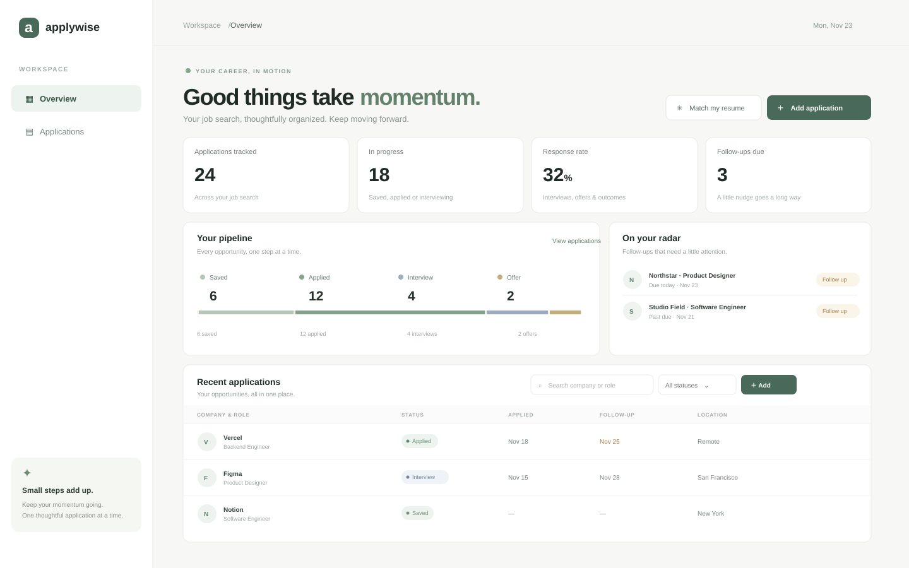

# ApplyWise

**A thoughtful, data-aware workspace for a more intentional job search.** ApplyWise helps candidates organize applications, stay ahead of follow-ups, and understand how closely their experience matches a role—all from one lightweight dashboard.



## Why this project

Job searching creates a surprising amount of operational work: keeping application details straight, remembering when to follow up, and tailoring a resume to each role. ApplyWise brings those workflows together in a small, self-hostable app. Its matching tool is deliberately transparent: it compares meaningful terms in a resume and job description and shows both overlap and missing terms, instead of presenting an opaque AI score.

## Features

- Track applications across a clear hiring pipeline, with company, role, source, dates, salary, notes, and links.
- Search and filter applications by status or keyword.
- See pipeline totals, response rate, upcoming follow-ups, and recent activity.
- Compare resume text with a job description to get an explainable match score and useful keyword gaps.
- Persist data locally in SQLite using Python's built-in `sqlite3`; no account, API key, or database package required.
- Use a responsive dashboard and a documented JSON API.

## Run locally

Requires Python 3.10+.

```bash
python -m venv .venv
# Windows PowerShell: .venv\Scripts\Activate.ps1
# macOS/Linux: source .venv/bin/activate
pip install -e .
uvicorn applywise.main:app --reload
```

Open [http://127.0.0.1:8000](http://127.0.0.1:8000). Interactive API docs are at `/docs`. The database is created as `applywise.db` in the current directory; set `APPLYWISE_DATABASE_PATH` to choose a different file.

To preview the dashboard with fictional examples, stop the server and run `python -m applywise.seed_demo`, then start the server again. Demo data is only inserted into an empty database.

## API at a glance

| Method | Route | Purpose |
| --- | --- | --- |
| `GET` | `/api/overview` | Dashboard metrics and follow-ups |
| `GET` | `/api/applications` | List, search, and filter applications |
| `POST` | `/api/applications` | Add an application |
| `PATCH` | `/api/applications/{id}` | Update application details or status |
| `DELETE` | `/api/applications/{id}` | Remove an application |
| `POST` | `/api/match` | Compare resume and job description text |

## Design notes

The matching service uses normalized term frequency and inverse document frequency (TF–IDF) across the two pasted texts to rank shared and missing terms. It intentionally ignores common stop words and short tokens. The result is an assistive signal, not a hiring prediction: role language varies, and a candidate should review the suggested gaps in context.

The API uses Pydantic validation and Python's standard-library SQLite support. The browser interface is plain HTML, CSS, and JavaScript so the project stays easy to run and inspect without a frontend build tool.

## Project structure

```text
applywise/
├── applywise/
│   ├── main.py          # FastAPI routes and app setup
│   ├── database.py      # SQLite configuration and schema
│   ├── models.py        # SQL operations and data serialization
│   ├── schemas.py       # Request and response validation
│   ├── matching.py      # Explainable TF–IDF comparison
│   └── static/          # Responsive dashboard
├── docs/                # Project screenshots and diagrams
├── pyproject.toml
└── README.md
```

## Next steps

Good extensions include calendar reminders, CSV import/export, authentication for multi-user hosting, and testing the API and matching behavior. The current version is designed as a complete local-first portfolio project that can be extended in those directions.

## License

MIT. See [LICENSE](LICENSE).
